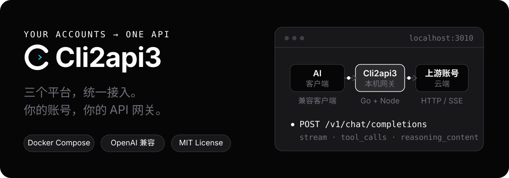
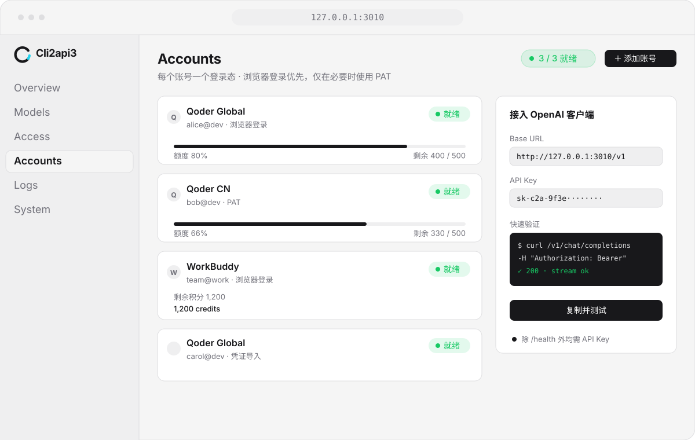
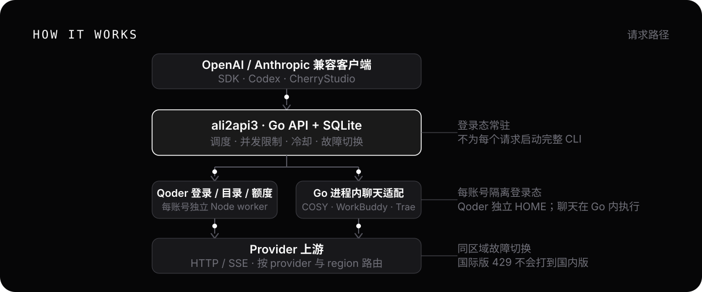

<div align="center">

<h1> Cli2api3</h1>

**把 Qoder、WorkBuddy、Trae 接入同一个 API**

面向个人自用的多平台 AI 反向代理工具。统一管理登录、模型、用量与更新，连接你常用的 AI 客户端。

[](https://github.com/cokeeven/Cli2api3/actions/workflows/ci.yml)
[](https://github.com/cokeeven/Cli2api3/releases/latest)
[](LICENSE)

[English](README_EN.md) · [快速开始](#快速开始) · [部署文档](deploy/README.md) · [版本记录](CHANGELOG.md) · [问题反馈](https://github.com/cokeeven/Cli2api3/issues)



</div>

Cli2api3 将你自己持有并有权使用的上游账号接入 **OpenAI / Anthropic 兼容接口**，支持聊天、流式输出和工具调用。用一个地址连接客户端，在 Web 控制台查看账号状态、选择模型、创建接入密钥并管理服务更新。

## 使用说明与项目声明

Cli2api3 是一个非官方的 AI 协议适配与反向代理工具，面向个人自用、协议兼容研究和开发测试。使用前请了解以下事项：

1. **自备账号与使用权限**

   请仅接入自己持有且有权用于相应用途的账号，并遵守对应平台的服务条款、额度限制及使用规则。本项目不提供账号、订阅或模型额度。

2. **非官方项目**

   本项目与所接入平台不存在官方隶属或背书关系。平台名称、商标及相关服务归各自权利人所有。

3. **使用范围**

   项目围绕个人客户端接入与账号管理维护，不提供公共中转服务，也不为第三方的账号售卖、额度转售、卡密收费或托管服务提供背书。

4. **兼容性与账号风险**

   兼容接口不代表完整复刻官方 API。上游协议、模型、额度及风控策略变化，可能导致功能失效、请求受限或账号受到限制；项目不承诺持续可用或账号不受影响。

5. **凭据与数据保护**

   默认仅监听本机地址。请勿直接公开管理控制台、更新器或服务端口。妥善保管账号凭据、接入密钥和数据库备份，提交问题或截图前先清除敏感信息。模型请求仍会发送至所选上游服务。

6. **开源许可与来源**

   本项目保留上游 MIT 许可证及版权声明。代码的开源许可不代表获得任何上游账号、模型或服务的额外使用授权。

## 核心能力

| 能力 | 可以做什么 |
|---|---|
| 统一 API | 提供 Chat Completions、Responses、Anthropic Messages 和模型列表；具体能力由适配器与上游模型共同决定 |
| 多账号调度 | 会话粘性、并发限制、限流冷却、账号故障切换，以及按客户端密钥设置的平台优先级 |
| 调用方指令 | 默认保留调用方的 `system` / `developer` 指令和工具定义，按上游协议适配消息角色 |
| 用量与护栏 | 查看额度、用量和积分有效期；按平台能力设置 Token 或积分护栏，明确区分实际用量与估算责任 |
| 账号维护 | 登录与凭据刷新、模型目录、签到和 WorkBuddy 国内任务记录；自动维护可独立开关 |
| 可控更新 | 从本仓库下载正式版本，确认后升级；升级前排空请求、校验备份，程序回退默认保留当前数据库 |

## 平台范围

| 平台 | 接入范围 | 真实验证范围 |
|---|---|---|
| Qoder | 国内版、国际版 | 国内账号的普通聊天、流式输出、工具调用和额度刷新已验证；国际版待真实账号验收 |
| WorkBuddy | 国内版、国际版 | 国内账号的普通聊天、流式输出、工具调用和额度刷新已验证；国际版与部分活动分支待验收 |
| Trae | 国内版 | 普通聊天、流式输出、工具调用和额度刷新已验证；登录交互与自然过期重登仍需验收 |

上述验证使用有限的国内账号与模型，不代表所有模型、账号类型和平台活动均已覆盖。仓库保留 Devin、Command Code 等实验适配器，当前维护重点为上述三个平台。

## 快速开始

准备 Docker、Docker Compose，以及你自己控制的上游账号。Windows / macOS 使用 Docker Desktop，Windows 需启用 Linux containers。

```bash
git clone https://github.com/cokeeven/Cli2api3.git
cd Cli2api3
docker compose -f deploy/docker-compose.yml pull
docker compose -f deploy/docker-compose.yml up -d
docker compose -f deploy/docker-compose.yml logs --tail=50
```

1. 保存首次启动日志中打印的**管理员密钥**。
2. 打开 `http://127.0.0.1:3010`，登录控制台并添加账号。
3. 在「API 密钥」创建**客户端密钥**，到「API 接入」查看模型并测试。

默认使用正式镜像 `ghcr.io/cokeeven/ali2api3:latest`。需要固定版本、从源码构建或安装宿主更新器时，按 [部署文档](deploy/README.md) 操作。

项目现名为 **Cli2api3**；镜像仓库保留原有名称 `ali2api3`，用于兼容已部署版本的更新配置。

## 接入客户端

在支持对应兼容协议的客户端中填写：

```text
Base URL: http://127.0.0.1:3010/v1
API Key:  <控制台创建的客户端密钥>
Model:    <API 接入页面或 /v1/models 返回的模型 ID>
```

| 协议 | 接口 |
|---|---|
| OpenAI Chat Completions | `POST /v1/chat/completions` |
| OpenAI Responses | `POST /v1/responses` |
| Anthropic Messages | `POST /v1/messages` |
| 模型列表 | `GET /v1/models` |

客户端获取模型列表时，模型 ID 和显示名会带平台前缀，例如 `workbuddy/glm-5.3`、`trae/glm-5.3`、`qoder/模型名`（以各平台实际目录为准）。直接选用拉取到的 ID 即可固定平台；同平台仍可轮换账号。开启跨 Provider 模型池时，原有无前缀模型调用继续可用；关闭后需使用带前缀的 ID。更新程序后，在客户端重新获取模型列表。

工具调用由客户端执行工具并回传结果；不同协议并不保证覆盖官方 API 的全部功能。固定账号、会话标识、平台前缀和请求示例见 [部署文档](deploy/README.md)。

## 控制台与账号管理

<p align="center">
  
</p>

- **账号与模型**：管理登录、启停、凭据刷新、代理和模型目录，查看账号就绪状态与额度。
- **密钥与调度**：管理员密钥管理控制台，客户端密钥访问 `/v1/*`；每个客户端密钥可配置平台授权、优先级和并发限制。
- **维护与日志**：按需启用签到和自动维护，查看签到、任务步骤与请求记录。活动奖励以平台实际资格和读回结果为准。

跨平台故障切换默认关闭；显式平台前缀、权限和地域约束始终有效。用量护栏默认关闭；开启严格护栏后，无法确定可信成本上界的请求可能被拒绝，积分倍率不能代替实际成本。控制台图片为界面示意。

## 更新与数据保护

正式版本来自 [本仓库 Releases](https://github.com/cokeeven/Cli2api3/releases) 与 `ghcr.io/cokeeven/ali2api3`。安装宿主更新器后，可在系统设置中**先下载、再确认升级**。托管更新支持 Docker Compose；Windows amd64 原生部署首次按[接入说明](deploy/README.md#windows-native-updates)安装独立更新器后，也可使用同一网页流程。原生运行包及安装脚本须来自包含本功能的正式版本，不能仅安装旧版 updater.exe。

- 升级前等待在途请求结束，创建 SQLite 一致快照并校验完整性；排空或校验失败时停止升级。
- 程序与持久数据分离；默认程序回退保留当前数据库，旧库恢复需要独立验证与保全最新数据。
- 版本检查、更新器附件和程序镜像分别支持配置备用源；更新 HTTP 请求可配置代理，备用镜像按发布摘要拉取。

**备用源需要自行填写可用地址，默认不内置第三方加速站。** 配置方式见 [更新网络与备用源](deploy/README.md#update-network-and-mirrors)。国内账号基础调用，以及真实 Windows 宿主上的升级、程序回退和更新后数据保留已验证；其他主机环境仍需单独验收。重要数据请保留独立备份。

## 工作方式

<p align="center">
  
</p>

Go 网关负责鉴权、调度、协议适配和请求记录，SQLite 保存持久数据。Qoder 的登录、目录与额度使用每账号隔离的 Node worker，聊天走 Go 内的 COSY 客户端；WorkBuddy、Trae 使用 Go 进程内适配器。

## 使用边界

- 自备账号与额度；模型、图片和工具能力取决于上游。WorkBuddy / Trae 当前不支持图片，文件输入会明确拒绝。
- 调用方指令默认保留，但上游服务内部的隐藏指令不可由反代侧删除。已有账号的提示词设置以各自配置为准。
- 登录回调、凭据自然过期、国际账号及部分签到活动仍需按场景验收；不承诺全部平台活动自动完成。
- 上游协议变化可能影响兼容性；请求日志默认不保存提示词或回复正文。

## 文档与贡献

- [部署与运维](deploy/README.md) · [变更记录](CHANGELOG.md) · [开发与发布](docs/DEVELOPMENT.md)
- [架构说明](docs/ARCHITECTURE_SUMMARY.md) · [贡献指南](CONTRIBUTING.md) · [安全报告](SECURITY.md)
- [GitHub Issues](https://github.com/cokeeven/Cli2api3/issues) · [LINUX DO 社区](https://linux.do)

默认仅监听 `127.0.0.1:3010`，面向本机客户端使用。请勿直接公开服务端口或管理控制台，并妥善保管账号凭据、接入密钥和数据备份。详细安全说明与漏洞反馈方式见 [安全报告](SECURITY.md)。

## 来源与许可证

基于 [caigee-cmd/cli2api](https://github.com/caigee-cmd/cli2api) 继续开发，保留上游 [MIT 许可证](LICENSE) 与版权声明；Go module 沿用原路径以保持兼容。感谢 `workbuddy2api`、`CLIProxyAPI`、`sub2api` 等项目提供的思路与启发。使用上游账号时请遵守对应平台的服务条款。
