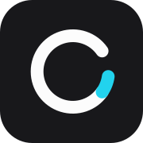
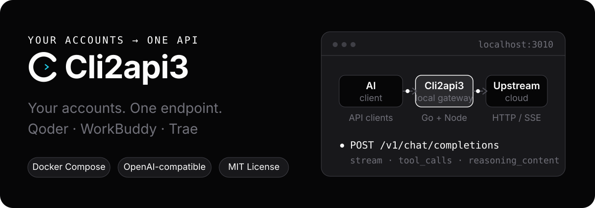
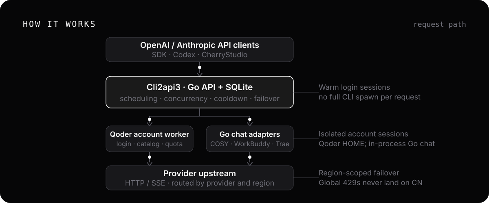
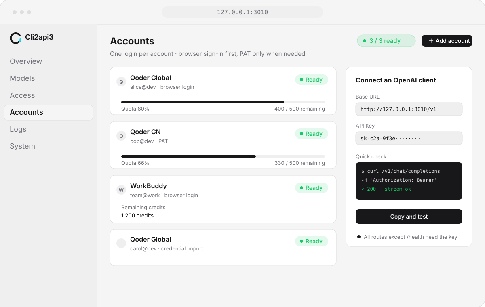

<div align="center">

<h1> ali2api3</h1>

**Turn your own logins into a local OpenAI-compatible API**

Connect **Qoder (Global / CN)**, **WorkBuddy (Global / CN)**, **Trae CN Work**, and experimental **Devin** and **Command Code** accounts.

Deploy with Docker, manage accounts in the web console, and connect clients through compatible APIs.

[](LICENSE)
[](https://linux.do)

<sub>[中文](README.md) · [Issues](https://github.com/cokeeven/ali2api3/issues) · [LINUX DO](https://linux.do)</sub>



</div>

This repository is published as **ali2api3**, developed from [caigee-cmd/cli2api](https://github.com/caigee-cmd/cli2api), with its MIT license and copyright retained. Additions include per-key platform priorities and concurrency, account usage guardrails and credit-expiry analysis, WorkBuddy CN daily tasks, and confirmed check-in outcomes. The Go module retains the upstream name for package compatibility.

Build this branch from source. References below to upstream images and managed updates do not imply that they include these changes. Account data, credentials, and local instance configuration are excluded from the public repository.

## Features

- **Compatible APIs**: Chat Completions, Responses, Anthropic Messages, and model listing, with streaming and function tools.
- **Multi-account routing**: automatic selection, session affinity, concurrency limits, cooldowns, and failover.
- **Web console**: manage accounts, models, client keys, and proxies; view quotas and request logs.
- **Docker operations**: persistent account data; an optional host updater lets you download, confirm, and roll back updates from the console.

Qoder CN, WorkBuddy, and Trae adapters are implemented. WorkBuddy CN and Trae CN have partial live-account acceptance; the scope and remaining branches are described below. Devin and Command Code are experimental, not production-ready. Live upgrade and rollback acceptance is also pending.

## Quick start

You need Docker and an upstream account you control. Use Docker Desktop on macOS / Windows; Windows must use Linux containers.

```bash
git clone https://github.com/cokeeven/ali2api3.git
cd ali2api3
docker compose -f deploy/docker-compose.yml up -d --build
docker compose -f deploy/docker-compose.yml logs --tail=50
```

1. Save the **administrator key** printed in the first-start logs.
2. Open `http://127.0.0.1:3010`, sign in with that key, and add an account in **Accounts**.
3. Create a client key in **API keys**, then choose a model and test it in **Access**.

Edit a client key to configure **platform routing**: higher priorities run first, and each platform concurrency cap covers all models used by that key. Existing provider grants remain the authorization boundary. New sessions without routing preferences choose platforms uniformly at random; account selection then follows the account scheduling strategy. Existing sessions retain affinity, and temporary capacity overflow borrows another account on the same platform. Model limits and confirmed insufficient-credit rejections can advance to the next account serving the same model. Cross-provider failover defaults off; explicit provider model prefixes remain binding.

The account menu's **Usage and guards** controls reserve credits, daily tokens, daily credits, and per-model daily tokens, and shows credit expiry and daily usage. All guards default off. Strict credit guards reject paid requests whose cost upper bound cannot be established; credit multipliers alone are not trusted quotes. Actual usage, estimated reservations, and unknown charges remain distinct. Cancellation does not imply zero cost. Manual reconciliation only acknowledges that a specified fresh balance snapshot already includes an unknown liability; it does not invent per-request costs. Expiry preference applies within the selected platform and does not override session affinity.

Docker Compose is the supported install and managed-update path; source runs are for development. See the [deployment guide](deploy/README.md).

## Connect a client

In an OpenAI-compatible client, enter:

```text
Base URL: http://127.0.0.1:3010/v1
API Key:  <a client key created in API keys>
```

Get a model ID from **Access** or `/v1/models`. Routing is automatic and prefers the same account for later turns. Account pinning, session headers, and curl / PowerShell examples are in the [deployment guide](deploy/README.md).

## How it works

<p align="center">
  
</p>

The Go gateway handles authentication, routing, and request logging. Each Qoder account has its own Node process and HOME; WorkBuddy, Trae, Devin, and Command Code use Go in-process adapters. No full CLI is started per request.

## Console

<p align="center">
  
</p>

Accounts, models, access, and logs all live in one web console: readiness and quota are visible at a glance, and the Access page lets you copy the Base URL and run a quick check.

Account cards provide WorkBuddy, Qoder CN, and Qoder Global check-in actions and automatic check-in switches (off by default), with history under More → Check-in records; no separate check-in page is needed. Set each provider's default time under System → Automatic check-in, then choose inheritance or an override in Edit account. Default changes apply to inheriting accounts immediately. Existing WorkBuddy accounts retain their previous times until switched to inheritance. Inactive campaigns are skipped. Live acceptance is tracked separately for each provider and campaign branch. Trae CN distinguishes account completion from a device limit; only a claim confirmed by upstream readback reports a new reward. Repeated manual checks do not reuse an old success result.

Personal WorkBuddy CN account cards provide **Run daily tasks** and **More → Daily task history**, with individual success, already completed, skipped and failed results. The pipeline covers check-in, daily activity, the Buddy prerequisite, growth acceptance and progress, travel, yesterday's missed-day makeup, streak redemption, existing lottery chances, gifts and compensation. Progress, claims, makeup and redemptions require upstream readback confirmation. Makeup uses existing cards only; each run draws at most five existing chances and defers remaining chances to bounded retries. Tasks requiring real desktop actions, subscriptions, donations or night activity across days are explicitly skipped. No paid conversations are generated. This pipeline excludes Global and enterprise accounts.

Daily task completion shows a brief result notice and no longer opens history automatically. Open **More → Daily task history** manually, or use **Logs → Check-in & daily tasks** for standalone check-ins, daily task runs and retries across providers. Filter by account, provider, operation, status, trigger and time, and open step details manually. New check-in steps are linked to their parent daily task run to avoid duplicate rows. Older standalone check-ins remain intact and use an unknown trigger when its origin cannot be established. Reading logs does not run upstream tasks.

The **Automatic check-in & daily tasks** master switch in that tab applies to this instance only and defaults to on to preserve current behavior. Turning it off pauses automatic check-ins, daily tasks and retries without changing account options or enablement. Turning it on resumes the original settings. Manual actions, chats, login and token refresh remain available. Instances with separate databases have independent switches and logs.

With the master switch on, enabled WorkBuddy CN accounts that opt into automatic check-in participate after 22:00 server local time. SQLite stores run history and check-in results atomically. Per-account leases prevent overlapping runs, and persisted successes survive restarts. Failed scheduled runs retry after 5/10 minutes, at most three attempts per local day, preserving each confirmed task. Accounts have independent 90-second deadlines and a concurrency limit of four. Each run submits at most 20 growth events, at least one second apart. Manual runs do not require automatic check-in to be enabled. Separate databases never share task history or execution leases. Copies of the same account still share upstream rewards and refresh-token effects, so live acceptance must run serially.

Live acceptance on 2026-10-15 verified CN queries, growth progress and reward readback, and structured run persistence. Missed-day makeup, unlocked streak redemption, nonzero lottery chances, and travel departure/arrival claims have local regression coverage but still require eligible live-account acceptance. Passing tests does not mean every campaign branch has been exercised live or deployed.

## Limitations

- Bring your own accounts. CLI2API does not supply accounts, quotas, or an official API service.
- Compatibility is not full API parity. Messages / Responses are stateless adapters, without server-side conversations or upstream-specific tool execution.
- Image support depends on the upstream and model. WorkBuddy / Trae do not support images; file inputs are rejected. See the [deployment guide](deploy/README.md) for details.
- Cross-provider routing for shared model IDs follows system settings, key grants, and region constraints; failover is not unrestricted.
- Upstream changes can break compatibility. Request logs do not store prompt or completion bodies by default.

## Documentation

- [Deployment and operations: setup steps, environment variables, endpoints, managed updates](deploy/README.md)
- [Changelog](CHANGELOG.md)

## Security

The default deployment exposes only `127.0.0.1:3010`; do not expose it directly to the public internet. Administrator keys manage the console; client keys only access `/v1/*`. Protect keys, credential exports, and database backups. Report security issues privately as described in [SECURITY.md](SECURITY.md).

## Community & Contributing

Chinese-language discussion is on [LINUX DO](https://linux.do). Bugs and feature requests go to GitHub [Issues](https://github.com/cokeeven/ali2api3/issues); documentation improvements and pull requests are welcome — see [CONTRIBUTING.md](CONTRIBUTING.md).

## Acknowledgements

Thanks to open-source projects including `workbuddy2api`, `CLIProxyAPI`, and `sub2api` for ideas and inspiration.

## License

[MIT](LICENSE). Follow each upstream platform's terms when using its accounts.
